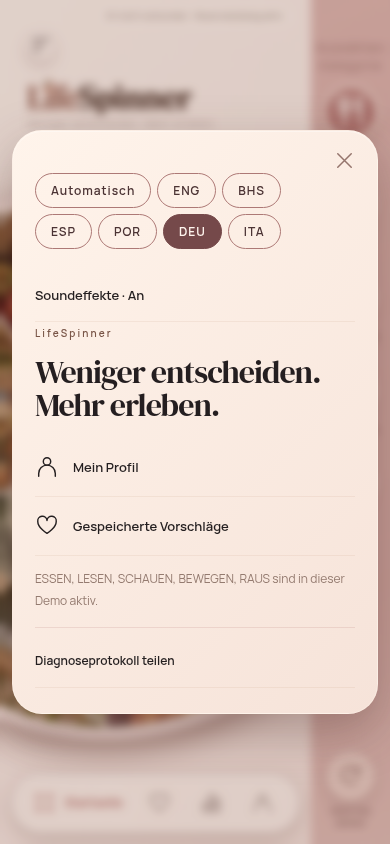

# Pregled UI prijevoda na Macu

[Preuzmi ZIP](https://github.com/salemko72/RANDOM-life/raw/refs/heads/codex/salem-language-preview/review-previews/LifeSpinner-Languages-Preview.zip), raspakuj i dvoklikni **LifeSpinner-Translations.html**. Jezici su u početnom podešavanju i meniju: ENG/BHS/ESP/POR/DEU/ITA. Ne treba instalacija niti API ključ.

Ovo je zaseban draft UI preview sa365tekstova po novom jeziku. Katalog za nove jezike ostaje English offline rezerva. Nema produkcijskog deploya, promjene objavljene aplikacije ili novog TestFlight/Android builda. Automatic u ovom preglednom paketu bira English.

Remote transport je blokiran; Studio i app/item sharing su isključeni. localStorage i sessionStorage imaju zaseban review namespace, katalog je memory-only: Clear catalog cache ne dira raniji IndexedDB. Paket ne sadrži korisničke profile ili tajne.

Testirano u Chromiumu preko lokalnog HTTP-a, sva4nova jezika: setup/prehrambene oznake/save/menu, cache clear i očuvanje postojećeg storage/IndexedDB sentinel stanja. Chrome ovog cloud okruženja blokira file:// politikom administratora, pa stvarni Mac/Safari/Chrome file-open ostaje ručna provjera. Ako lokalni HTML preglednik blokira, probaj Chrome; ne mijenjati sistemske sigurnosne postavke.

App source2c0ce132f6dcfca7967143f880e0a949e40dae59; review builder96983f36f4387034e7907a41266f19400fc072fb. ZIP integritet/HTML bytes su provjereni, [SHA256](SHA256.txt). Reprodukcija: `node scripts/build-language-review.mjs /tmp/lifespinner-language-review` pa `node scripts/smoke-language-review.mjs /tmp/lifespinner-language-review/LifeSpinner-Translations.html`. Produkcijski preview-dist/native generated izvodi nisu prepisani.

