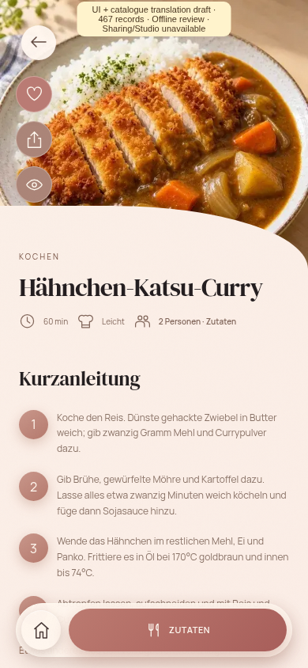

# Novi puni preview — interfejs i467prevedenih stavki

[**Preuzmi novi ZIP za Mac**](https://github.com/salemko72/RANDOM-life/raw/refs/heads/codex/salem-content-translations/review-previews/LifeSpinner-Catalogue-Preview.zip). Raspakuj i otvori **LifeSpinner-Catalogue-Preview.html** u Chromeu/Safariju. Odaberi ESP/POR/DEU/ITA pri podešavanju ili u meniju. Ovaj ZIP ima drugačiji naziv od ranijeg UI-only paketa.

Sadrži147recepata,172knjige,101film/seriju,27aktivnosti i20izlazaka;467×4=1868novih record translations. Prevedeni su opisi, sastojci/jedinice/koraci, žanrovi i preporuke. Izvorni naslovi BOOK/WATCH i autori su sačuvani. Svih100offline stavki pokriveno je istim prijevodima. UI ima365ključeva pojeziku. Automatic u ovom review paketu bira English.

Sve slike i fontovi su lokalno zapakovani, bez image generationa ili vanjskog prevodilačkog API-ja. Studio, app/item/LISTEN share i vanjska navigacija su blokirani. Review localStorage/sessionStorage su odvojeni, katalog memory-only; postojeći IndexedDBcache/profile nisu mijenjani. Source/data ne sadrže korisničke profile ili tajne.

**Produkcijska D1baza, AppStore/Play i native buildovi nisu ažurirani.** Ovo je pregledni jezički draft. Native/public Locale ostaje en/bs do activation koraka; šest jezika se izlaže samo u zasebnom review bundleu. [Operator predaja i važne compatibility/recipe-wording publikacijske zavisnosti](../docs/CONTENT_TRANSLATION_HANDOFF.md).

Provjere:376tests/58filesPASS, TypeScript i normalni previewPASS;4jezika×5kategorija za stvarni puni dataset, tekst/sastojci/koraci i artworkblobPASS. Providerlink click/Enter bez popup-a, sve3share funkcije cancellation-only. Review setup/profile/menu/cache clear čuva production storage sentinele. Cold reserve100/cached/draft400PASS. EN/BHS auto/profile/menu/SpinAgain/Home regresijePASS. Nije fizički Android/iPhone QA, ljudska lektura/medicinska validacija ili dokaz da su ranija prava na izvore riješena.

CloudChrome blokira file:// politikom administratora; isti HTML byteovi testirani su preko127.0.0.1. Stvarni Mac file-open ostaje korisnička provjera (raniji samostalni paket je otvoren). Ne mijenjati sistemske sigurnosne postavke.

App/catalogue source **b8fa083ea010468a0cb42b67b540dc2516fa42d3**; review source **20bc5d9657cb767c7bbf9b5004a755deb47e7f83**. ZIP integritet i identitet HTML-a provjereni; [SHA256](SHA256.txt). [Source/memories/patch](../content/i18n-2026-11-18/README.md).

